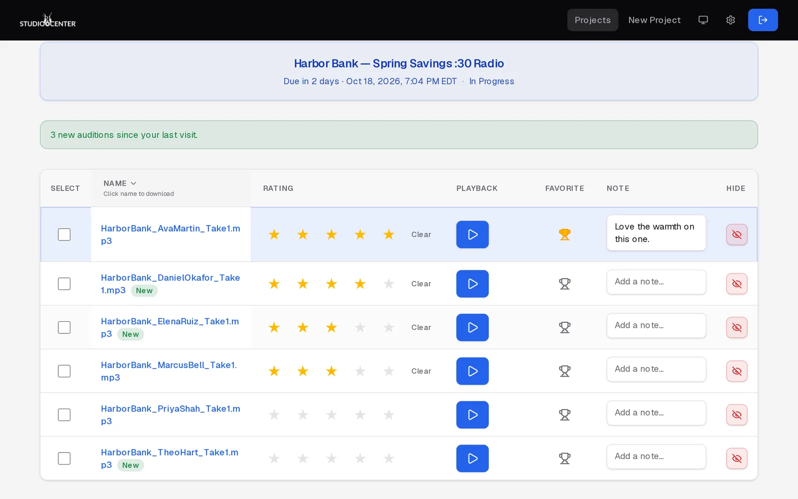

  

<h1 align="center">Studio Center Auditions</h1>

  <strong>Hear every take. Choose your voice.</strong> 
  The site behind <a href="https://studio-center.github.io/auditions/">studio-center.github.io/auditions</a>, the public introduction to Studio Center Auditions.

  <a href="https://studiocenterauditions.com/auth/signin">Client sign in</a> ·
  <a href="https://www.studiocenter.com">StudioCenter.com</a>

  

## What it is

Studio Center Auditions is where our clients review voice auditions for their
projects: listen to every take, rate and favorite the performances they like,
leave notes for our casting team, and book talent in a click, on any device.
Our producers and coordinators run casting from the same place.

## This repository

A single static page (`index.html` plus `assets/`), published with GitHub
Pages from the `main` branch. No build step: edit and push. Screenshots use
made-up demo data, not real projects, clients, or talent.

© Studio Center. All rights reserved.
