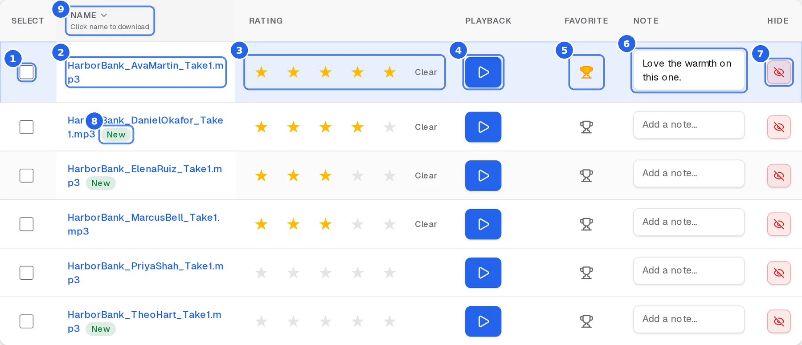

  

<h1 align="center">Studio Center Auditions Guide</h1>

  How to use Studio Center Auditions, published at
  <a href="https://studio-center.github.io/auditions/"><b>studio-center.github.io/auditions</b></a>

  <a href="https://studio-center.github.io/auditions/client-guide.html">Client guide</a> ·
  <a href="https://studio-center.github.io/auditions/staff-guide.html">Staff guide</a> ·
  <a href="https://studiocenterauditions.com/auth/signin">Sign in</a>

  

## What's here

| Page | For | Covers |
|---|---|---|
| [`index.html`](index.html) | Everyone | Overview, quick start, common questions |
| [`client-guide.html`](client-guide.html) | Clients | Signing in, reviewing and rating takes, booking, downloads, phone use, shortcuts, account |
| [`staff-guide.html`](staff-guide.html) | Studio Center team | 2FA, dashboard, projects, creating projects, auditions, talent, client emails, phases, tools, reports, automatic emails |

## Editing

Plain HTML with one stylesheet (`assets/site.css`); no build step. Edit and
push to `main`, and GitHub Pages republishes in a minute or two.

Screenshots in `assets/guide/` use made-up demo data (not real projects,
clients, or talent). The numbered markers on them match the numbered lists
under each figure, so when an app screen changes, retake its screenshot and
check the numbers still line up.

© Studio Center. All rights reserved.
